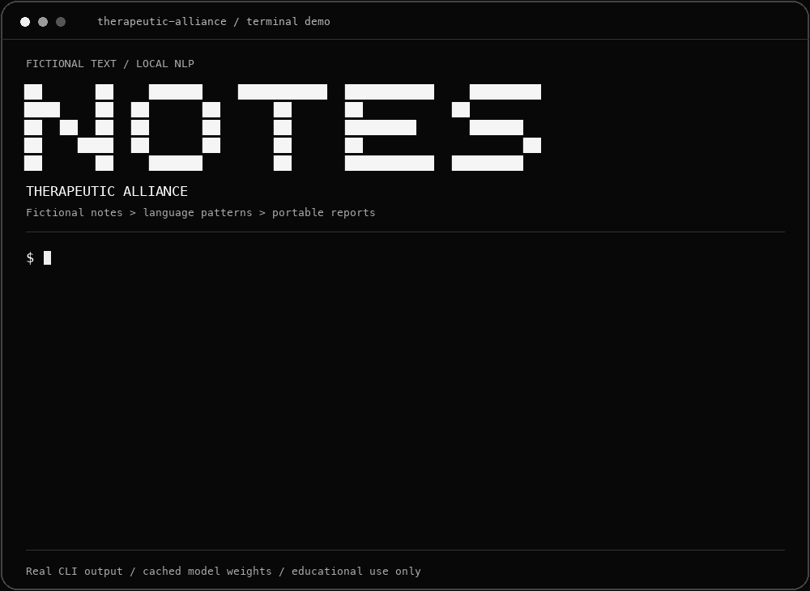

# Therapeutic Alliance

**Local NLP for fictional therapy notes.** Explore sentiment, seven emotion scores,
and language patterns with spaCy, Transformers, pandas, and Matplotlib.

> For learning only. These scores describe text; they do not diagnose conditions,
> measure therapeutic alliance, or establish whether therapy is working.

## See it in action



A replay of real CLI commands and output using ten fictional notes and cached
model weights. The terminal styling is illustrative; the commands run as shown.

## Quick start

Python **3.10+**; CPU inference, no API key required.

```bash
git clone https://github.com/Samuellyworld/therapeutic-alliance.git
cd therapeutic-alliance
python3 -m venv .venv
source .venv/bin/activate
python -m pip install -e '.[models]'
therapy-notes demo --output results/demo
```

Open `results/demo/report.html`. The first run downloads about 600 MB of model
weights. Add `--local-files-only` on later runs to use the cache.
On Windows, activate with `.venv\Scripts\Activate.ps1`.

## The pipeline



Original wording and negation are preserved. Long notes are split into chunks;
scores are averaged by token count. Model revisions are pinned and recorded.
The flowchart respects reduced-motion preferences.

## Your fictional data

```csv
client_id,session,note
fictional-A,1,"I feel anxious about work."
fictional-A,2,"The breathing exercise helped me pause."
```

Use unique client/session pairs, positive integer sessions, and non-empty English
notes containing words.

```bash
therapy-notes analyze --input data/synthetic_notes.csv --output results/analysis
```

Outputs: `analysis.csv`, `client_summary.csv`, `overview.png`, `report.html`, and
`manifest.json`. Use a new output directory to preserve previous runs.

For features without model downloads, install with `pip install -e .`, then run:

```bash
therapy-notes sample --output data/synthetic_notes.csv
therapy-notes preprocess --input data/synthetic_notes.csv --output results/features.csv
```

## Tests

```bash
python -m pip install -e '.[models,dev]'
ruff check .
RUN_MODEL_TESTS=1 pytest -q
```

Omit `RUN_MODEL_TESTS=1` to skip real-model downloads. CI checks Python 3.10 and
3.12. Use `therapy-notes --help` for command options.

## Models & license

[DistilBERT SST-2](https://huggingface.co/distilbert/distilbert-base-uncased-finetuned-sst-2-english)
provides positive/negative sentiment;
[DistilRoBERTa](https://huggingface.co/j-hartmann/emotion-english-distilroberta-base)
provides seven emotion scores. Neither is validated here for clinical use.

[MIT](LICENSE). Model weights retain their own terms. Contributions use `feat/`
or `fix/` branches and one squash-merged PR per feature.
