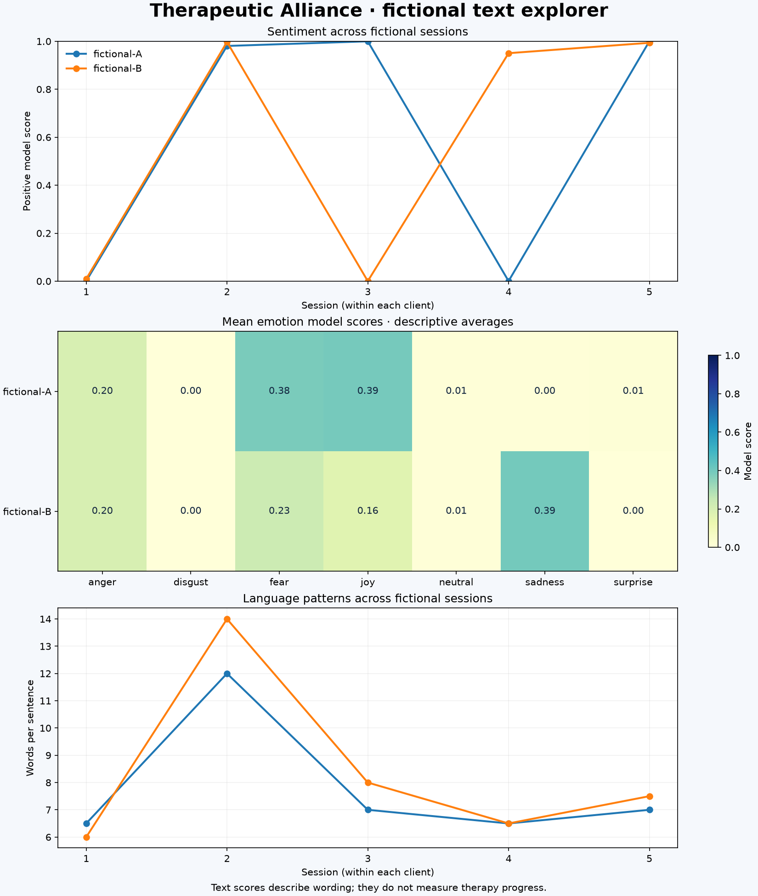

# Therapeutic Alliance

[](https://github.com/Samuellyworld/therapeutic-alliance/actions/workflows/tests.yml)
[](https://www.python.org/)
[](LICENSE)

**A practical Python NLP pipeline for exploring fictional therapy progress notes.**
Use spaCy, Hugging Face Transformers, pandas, and Matplotlib to examine sentiment,
emotion scores, and language patterns across fictional sessions. Run inference
locally and export a report you can open in any browser.

> **Learning only:** these general-purpose models have not been validated here for
> clinical use. Scores describe text. They cannot establish therapeutic alliance,
> diagnose a condition, determine whether therapy is working, or replace a trained
> professional. Use fictional English notes only.

## See it in action

```console
$ therapy-notes sample --output data/synthetic_notes.csv
Wrote 10 fictional notes to data/synthetic_notes.csv

$ therapy-notes preprocess --input data/synthetic_notes.csv --output results/features.csv
Wrote 10 fictional notes to results/features.csv

$ therapy-notes demo --output results/demo
```

The demo loads **real model weights**, analyzes the ten fictional notes, and writes
`results/demo/report.html`, two CSV tables, a chart, and a model provenance manifest.
The first model run downloads roughly 600 MB of weights; subsequent runs reuse the
Hugging Face cache. No account or API key is required for these public models.



## The pipeline


1. **Validate** the client IDs, positive session numbers, and non-empty notes.
2. **Preprocess** with spaCy's English tokenizer and rule-based sentence splitter.
3. **Classify** the original wording with sentiment and emotion models.
4. **Join and explore** model scores and language features within each fictional client.
5. **Export** full results, descriptive summaries, a portable report, and run metadata.

The black-and-white SVG animates the flow along each connection and highlights
stages in sequence. It respects reduced-motion preferences and remains readable
without animation. Rebuild it with `python scripts/render_architecture.py`; no
design tool or external font is needed.

## Contents

- [Quick start](#quick-start)
- [Use a fictional CSV](#use-a-fictional-csv)
- [Tools and models](#tools-and-models)
- [Understand the outputs](#understand-the-outputs)
- [What NLP can and cannot tell us](#what-nlp-can-and-cannot-tell-us)
- [Tests](#tests)
- [Project layout](#project-layout)
- [Troubleshooting](#troubleshooting)
- [Contributing](#contributing)

## Quick start

Use **Python 3.10 or newer**. A CPU is sufficient; the default inference device is CPU.

```bash
git clone https://github.com/Samuellyworld/therapeutic-alliance.git
cd therapeutic-alliance
python3 -m venv .venv
source .venv/bin/activate
# Windows PowerShell: .venv\Scripts\Activate.ps1
python -m pip install --upgrade pip
python -m pip install -e '.[models,dev]'
therapy-notes demo --output results/demo
```

Open `results/demo/report.html` in a browser. The chart is embedded, so the HTML
file works on its own and needs no web server.

### Lightweight, offline preprocessing

Model downloads are optional. Install the base package to explore linguistic
features without PyTorch or Transformers:

```bash
python -m pip install -e .
therapy-notes sample --output data/synthetic_notes.csv
therapy-notes preprocess --input data/synthetic_notes.csv --output results/features.csv
```

spaCy uses `spacy.blank("en")` plus a sentencizer. No `en_core_web_sm` download is
needed. This stage does not perform lemmatization, part-of-speech tagging, or named
entity recognition.

## Use a fictional CSV

```csv
client_id,session,note
fictional-A,1,"I feel anxious about work. I am not sleeping well."
fictional-A,2,"I still worry, but the breathing exercise helped."
fictional-B,1,"I miss my friends and feel lonely since moving."
```

```bash
therapy-notes analyze --input data/synthetic_notes.csv --output results/analysis
# After the first successful download, require cached model files:
therapy-notes analyze --input data/synthetic_notes.csv --output results/offline --local-files-only
```

`client_id` is text, `session` is a positive integer, and `note` is non-empty text
containing at least one alphabetic word. Each client/session pair must be unique.
Rows are sorted by client and session before analysis; additional input columns
are ignored. CSV quoting supports commas and multiline notes. IDs like `001` stay
intact. Session numbers are sequence identifiers, not dates or elapsed time.

All sample notes are authored fiction, with deliberately mixed and non-monotonic
language. There are no real patient records and no ground-truth clinical labels.
The CLI cannot verify whether supplied text is fictional; keep real records out
of this tutorial and its exports.

## Tools and models

| Tool | Role | Important detail |
| --- | --- | --- |
| [spaCy](https://spacy.io/api/language) | Tokens, sentence boundaries, language features | Original text and negation are retained |
| [DistilBERT SST-2](https://huggingface.co/distilbert/distilbert-base-uncased-finetuned-sst-2-english) | Positive and negative text scores | A two-label sentiment model fine-tuned on movie reviews; no neutral sentiment class |
| [Emotion English DistilRoBERTa](https://huggingface.co/j-hartmann/emotion-english-distilroberta-base) | Anger, disgust, fear, joy, neutral, sadness, surprise | All seven scores are retained, alongside the highest-scoring label |
| [pandas](https://pandas.pydata.org/docs/) | Validation, joins, summaries, CSV exports | Sessions remain grouped by fictional client |
| [Matplotlib](https://matplotlib.org/stable/) | Static charts | Headless rendering works in terminals and CI |

Built-in model revisions are pinned in `models.py`. The emotion model uses the
[SFconvertbot Safetensors conversion](https://huggingface.co/j-hartmann/emotion-english-distilroberta-base/discussions/3017)
of the original checkpoint. Weights use the Safetensors format, and remote model
code is disabled. Inference
runs on this machine; the code sends no note text to a hosted inference service.
Downloading public packages and model weights still requires an internet connection.

### Handling long notes

Each model tokenizes the **original note**, then splits token IDs into
non-overlapping chunks that fit its context window, including special tokens.
The model scores every chunk. Note-level scores are the token-count-weighted mean
of chunk softmax probabilities, and the highest mean score supplies the label.
`sentiment_chunks` and `emotion_chunks` make splitting visible in the CSV.

This avoids silent truncation. Chunk boundaries can lose context, and averaging
is a tutorial heuristic; it is not a validated clinical scoring method. Sentiment
and emotion models use different tokenizers, so their chunk counts can differ.

## Understand the outputs

| File | Contents |
| --- | --- |
| `analysis.csv` | Original fictional text, linguistic features, both sentiment scores, all seven emotion scores, labels, and chunk counts |
| `client_summary.csv` | Session counts and descriptive means per fictional client |
| `overview.png` | Sentiment by session, mean emotion scores by client, and sentence lengths |
| `report.html` | Portable report with embedded chart and escaped session table |
| `manifest.json` | UTC run time, input fingerprint, package versions, model commit revisions, device, aggregation rule, and limitations |

Outputs overwrite files of the same name in the chosen directory. Use separate
output directories to preserve different runs. Generated results and cached model
weights are ignored by Git; only the curated fictional demo preview is versioned.

### Linguistic features

- **Word count:** spaCy tokens consisting only of alphabetic characters.
- **Sentence count:** rule-based sentences containing at least one alphabetic token.
- **Mean sentence length:** word count divided by sentence count.
- **Lexical diversity:** distinct lowercase alphabetic tokens divided by word count.
- **First-person ratio:** tokens matching `I, me, my, mine, myself, we, us, our, ours,
  ourselves`, case-insensitively, divided by word count.

These are simple surface features. Contractions and punctuation affect tokenization;
lexical diversity also depends on note length. No clinical interpretation is
attached to any feature.

The manifest records the exact downloaded model revisions. To reuse those weights
programmatically, pass the recorded commit SHA as the classifier's `revision`
argument in `src/therapeutic_alliance/models.py`. Package ranges permit compatible
updates; use the recorded versions to reconstruct a particular environment.

## What NLP can and cannot tell us

The project helps you inspect **how text is worded** and learn how to assemble an
NLP pipeline. A model can assign positive sentiment to a note containing a difficult
experience, or negative sentiment to an honest and useful therapy conversation.
Its score is not a calibrated probability of a person's feelings.

General-language training data differ from therapy notes. Negation, quotations,
sarcasm, mixed emotions, dialect, and note-writer perspective can change predictions.
No evaluation against representative, independently labeled therapy notes is
included. The synthetic dataset is a software demonstration, not evidence of
accuracy, fairness, clinical validity, or treatment effectiveness.

Use human review to discuss surprising outputs. Do not rank clients or therapists,
flag clinical risk, or make care decisions from these scores.

## Tests

```bash
python -m pip install -e '.[dev]'
ruff check .
pytest -m 'not integration'
```

The regular suite checks CSV validation, ordering, negation preservation, feature
calculations, classifier contracts, HTML escaping, report exports, and CLI flows.
Its classifier fixtures are deterministic test doubles; the demo always runs real
models.

To download weights and verify **both real models**, including a note longer than
one context window:

```bash
python -m pip install -e '.[models,dev]'
RUN_MODEL_TESTS=1 pytest -m integration -v
# PowerShell: $env:RUN_MODEL_TESTS='1'; pytest -m integration -v
```

GitHub Actions runs lint, regular tests, and CLI smoke checks on Python 3.10 and
3.12 for every PR. Real-model tests are opt-in to avoid downloading large weights
for each routine CI run. These tests verify software behavior, not clinical accuracy.

## Project layout

```text
therapeutic-alliance/
├── data/synthetic_notes.csv      # ten fictional notes; two clients
├── docs/assets/                  # architecture SVG and actual demo chart
├── scripts/render_architecture.py
├── src/therapeutic_alliance/
│   ├── cli.py                    # sample / preprocess / analyze / demo
│   ├── data.py                   # fictional dataset and CSV validation
│   ├── preprocessing.py          # spaCy language features
│   ├── models.py                 # local transformer inference and chunking
│   ├── analysis.py               # prediction validation and joins
│   └── reporting.py              # CSV, PNG, HTML, and manifest exports
├── tests/                        # unit, CLI, report, and opt-in model tests
└── .github/workflows/tests.yml
```

## Troubleshooting

| Problem | Action |
| --- | --- |
| Installation fails on an old Python | Create a fresh environment with Python 3.10+; this project was tested locally with Python 3.12 |
| `therapy-notes` is not found | Activate the virtual environment and run `python -m pip install -e .` |
| Model support is missing | Run `python -m pip install -e '.[models]'` |
| First download stalls in Xet | Retry with `HF_HUB_DISABLE_XET=1 therapy-notes demo`; this uses the standard HTTPS downloader |
| Offline cache is incomplete | Run once online without `--local-files-only`, then retry offline |
| Memory is limited | Use `--batch-size 1`; CPU inference still needs memory for both models |
| CSV is rejected | Check column names, positive integer sessions, unique client/session pairs, and non-empty alphabetic text |

Use `therapy-notes --help` or `therapy-notes analyze --help` for command options.
Hugging Face's `HF_HOME` environment variable controls where weights are cached.

## Contributing

Use `feat/<feature>` or `fix/<issue>` branch names. Keep changes focused on one
feature or fix, run the relevant checks, and open a PR describing the resulting
behavior and validation. **Squash-merge each PR** so each feature lands as one
commit on `main`. Keep generated caches and unrelated changes out of commits.

## License

Project code is [MIT licensed](LICENSE). Third-party packages and model weights
retain their own licenses and terms; consult the linked model cards before reuse.
